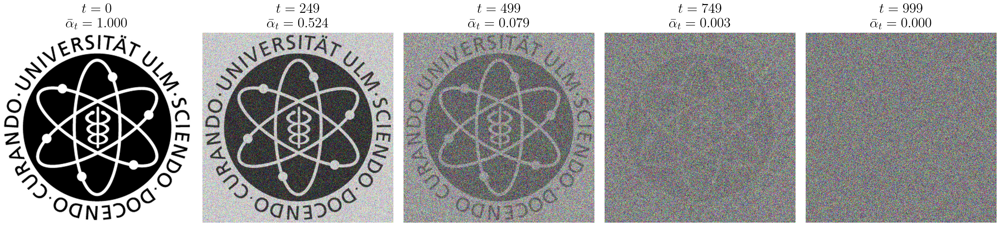
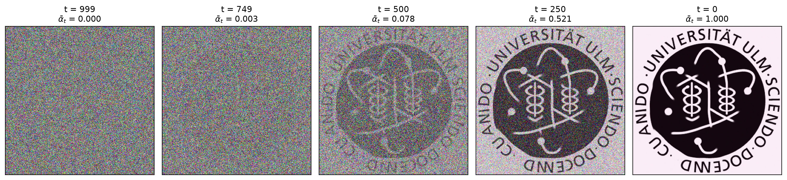

# Denoising Diffusion Models

Seminar *Concepts in Machine Learning*, Ulm University, 2026 — Milan Tóth

- **[Paper](paper.pdf)**: an introduction to diffusion models, from the original framework of Sohl-Dickstein et al. via DDPM to DDIM, improved DDPMs, latent diffusion, and conditioning/guidance.
- **[Presentation](presentation.pdf)**: the slides from the seminar talk.



**Forward process:** Gaussian noise is added to an image step by step with the linear DDPM schedule (T = 1000), until only noise remains.



**Reverse process:** a small DDPM trained on this single image for 18,000 steps starts from pure noise and recovers the image.
## Code

The scripts in `src/` produce the figures used in the paper and slides. All inputs are read from `images/` and all outputs are written there.

| Script | Output |
| --- | --- |
| `src/noising.py` | forward-process figures (`noising_steps*.png`, `diffusion_diagram.png`, `equation_diagram.png`) |
| `src/denoising.py` | trains a small DDPM on a single image and plots the reverse process (`figure_reverse_process.png`) |
| `src/latent_visualisation.py` | latent of a pretrained LDM autoencoder (`latent_out/`) |

```bash
pip install -r requirements.txt
python src/noising.py
python src/denoising.py --steps 3000 --max_side 256
python src/latent_visualisation.py
```

`ddpm.sh` is the SLURM job used to train the DDPM on a GPU cluster. Submit it from the repo root with `sbatch ddpm.sh`.
